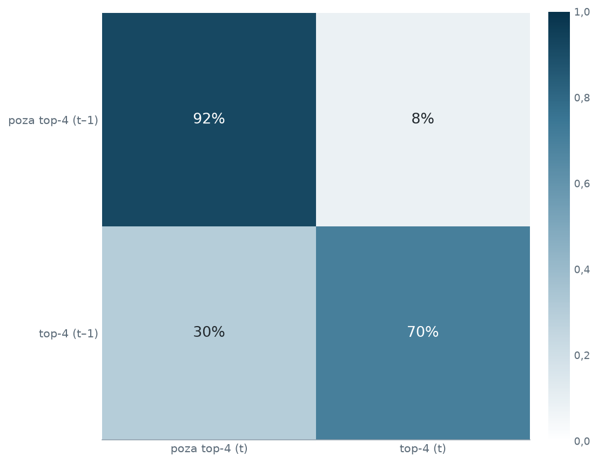
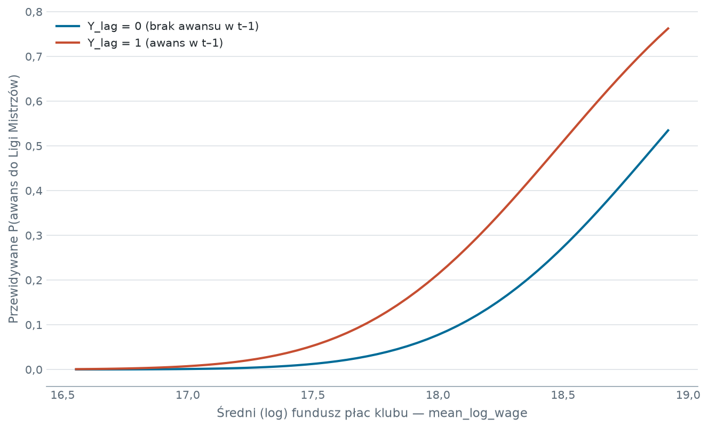
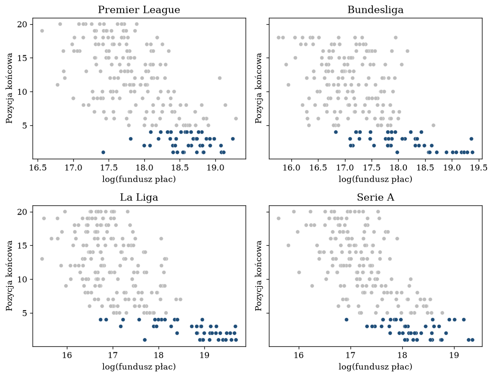

# Trwałość kwalifikacji do Ligi Mistrzów - dynamiczny probit CRE


Projekt rozdziela dwa źródła tego, że te same kluby regularnie awansują do Ligi Mistrzów: trwałość samej pozycji oraz trwałą zamożność klubu. Zmienna objaśniana jest binarna, panel niezbalansowany, a efekt klubu skorelowany z regresorami, więc zastosowano dynamiczny probit z korelowanymi efektami losowymi w ujęciu Wooldridge'a - z opóźnioną zmienną zależną, warunkiem początkowym i średnimi wewnątrzklubowymi.

Wynikiem jest rozróżnienie, którego model statyczny nie wykonuje: bieżący fundusz płac nie wyjaśnia awansu, natomiast trwały poziom funduszu płac i sam fakt awansu rok wcześniej - tak.

## Pytanie badawcze

Na ile prawdopodobieństwo awansu klubu do Ligi Mistrzów zależy od tego, że awansował w sezonie poprzednim, a na ile od jego funduszu płac. Osobno rozważana jest kwestia, czy liczy się bieżący poziom wydatków, czy trwała zamożność klubu.

## Dane

| | |
|---|---|
| Wyniki i wyceny | Transfermarkt: `games`, `club_games`, `player_valuations`, `transfers` |
| Fundusz płac | fbref, zebrany przez `notebooks/01_pobranie_plac.ipynb` |
| Jednostka panelu | klub × sezon |
| Ligi | Premier League, Bundesliga, La Liga, Serie A |
| Zakres | sezony 2013/14 - 2023/24, jedenaście sezonów |
| Liczebność | 858 obserwacji w panelu, 726 w próbie estymacyjnej, 115 klubów |

**Dane Transfermarkt nie są częścią repozytorium** - 65 MB i licencja dostawcy. Instrukcja pobrania w sekcji [Uruchomienie](#uruchomienie).

**Plik płac oraz panel analityczny są częścią repozytorium** (`data/raw/place_top4_ligi_2013_2023.csv`, `data/processed/panel_klub_sezon.csv`). Plik płac pochodzi z własnego pobrania, a panel pozwala powtórzyć wszystkie modele bez pobierania danych surowych.

### Liczebność w podziale na ligi

| Liga | Obserwacje | Kluby | Udział sezonów z awansem |
|---|---|---|---|
| Premier League | 186 | 31 | 0,215 |
| La Liga | 187 | 30 | 0,214 |
| Serie A | 184 | 28 | 0,217 |
| Bundesliga | 169 | 26 | 0,231 |

## Decyzje projektowe

**Zmienna celu wyznaczana w obrębie ligi i sezonu.** `Y = 1` dla klubów zajmujących jedno z czterech pierwszych miejsc w swojej lidze w danym sezonie. Ranking globalny spowodowałby, że kluby lig o niższych funduszach płac nigdy nie trafiłyby do pierwszej czwórki.

**Wartość kadry na dzień 1 lipca.** Dla każdego zawodnika brana jest jego ostatnia wycena nie późniejsza niż początek sezonu. Wyceny powstałe w trakcie sezonu są reakcją na jego przebieg, więc ich uwzględnienie wprowadziłoby zmienną objaśniającą zależną od zmiennej objaśnianej.

**Fundusz płac jako miara finansowa główna.** Waluta różni się między ligami, lecz w logarytmach stała przelicznika jest pochłaniana przez efekt stały ligi, więc ujednolicanie waluty nie jest potrzebne.

**Mapowanie nazw klubów wykonane ręcznie.** Nazwy w fbref i Transfermarkt różnią się skrótami („Manchester Utd" wobec „Manchester United"), więc dopasowanie automatyczne po nazwie zawodzi. Słownik znajduje się w `src/data_load.py`; liczba nazw niezmapowanych jest wypisywana przy każdym przebiegu i obecnie wynosi zero.

**Konstrukcja zmiennych CRE.** `Y_lag` to stan z sezonu poprzedniego, `Y_0` stan w pierwszym obserwowanym sezonie klubu, a `mean_log_wage` średnia wewnątrzklubowa funduszu płac. Bez warunku początkowego oszacowanie `Y_lag` byłoby obciążone efektem klubu; średnia Mundlaka rozdziela część wewnątrzklubową od międzyklubowej.

**Okienko transferowe ograniczone do czerwca-sierpnia roku rozpoczęcia sezonu.** Saldo transferowe ma mierzyć inwestycję poprzedzającą sezon, nie korektę dokonaną w jego trakcie.

**Błędy standardowe klastrowane po klubie.** Kolejne sezony tego samego klubu nie są niezależne.

## Kluczowe wyniki

### Stan jest trwały



Klub, który awansował w sezonie poprzednim, awansuje ponownie w 70% przypadków; klub spoza pierwszej czwórki wchodzi do niej w 8,3% przypadków. Są to częstości empiryczne, bez kontroli finansów.

### Model główny

| Zmienna | Współczynnik | Efekt cząstkowy (AME) |
|---|---|---|
| `Y_lag` - awans w sezonie t-1 | 0,627** (0,235) | 0,112** (0,052) |
| `log_wage` - fundusz płac | 0,028 (0,386) | 0,004 (0,055) |
| `Y_0` - warunek początkowy | 0,206 (0,211) | 0,031 (0,035) |
| `mean_log_wage` - średnia Mundlaka | 1,614*** (0,440) | 0,231*** (0,057) |

W nawiasach błędy standardowe klastrowane po klubie. Istotność: *** p<0,01, ** p<0,05. Pseudo-R² wynosi 0,503, a p dla testu LLR 8,81 · 10⁻⁷². Efekt cząstkowy dla zmiennych zero-jedynkowych jest różnicą dyskretną uśrednioną po próbie, dla zmiennych ciągłych pochodną. Wszystkie wartości są oszacowaniami punktowymi.

**Zależność stanu jest istotna.** Sam awans w sezonie poprzednim podnosi prawdopodobieństwo awansu o 11,2 punktu procentowego przy niezmienionym poziomie finansów.

**Bieżący fundusz płac nie wyjaśnia awansu.** Współczynnik wynosi 0,028 przy błędzie standardowym 0,386 i p = 0,942. Jednorazowe podniesienie wydatków na płace nie przekłada się na awans w tym samym sezonie.

**Liczy się trwały poziom funduszu płac.** Średnia wewnątrzklubowa daje współczynnik 1,614 przy p < 0,001. W dekompozycji Mundlaka część wewnątrzklubowa wynosi 0,004, międzyklubowa 0,231, a efekt trwałego podniesienia funduszu płac 0,235 na jednostkę logarytmu, co odpowiada 2,2 punktu procentowego przy wzroście płac o 10%.



Odstęp między krzywymi jest zależnością stanu: tyle daje awans w sezonie poprzednim przy tym samym poziomie płac. Siatka obejmuje zakres od piątego do dziewięćdziesiątego piątego kwantyla średniego funduszu płac, bez ekstrapolacji poza obserwowane wartości. Efekty stałe ustalono na sezonie 2019 i Premier League; wybór wpływa na poziom krzywych, nie na kształt zależności.

### Model statyczny myli oba kanały

| Specyfikacja | Współczynnik `log_wage` | Błąd standardowy | p |
|---|---|---|---|
| Statyczny probit (bez `Y_lag`) | 1,901 | 0,206 | < 0,001 |
| Dynamiczny probit CRE | 0,028 | 0,386 | 0,942 |

Po pominięciu opóźnionej zmiennej zależnej i średniej Mundlaka współczynnik przy bieżącym funduszu płac rośnie z 0,028 do 1,901 i staje się istotny. Bieżące płace przejmują wówczas to, co w pełnej specyfikacji jest trwałością pozycji oraz trwałą zamożnością klubu. Pseudo-R² spada z 0,503 do 0,450.



Oś pozycji jest odwrócona, więc wyżej oznacza lepsze miejsce. Kolorem wyróżniono sezony z awansem.

### Testy poprawności specyfikacji

| Test | Wynik | Odczyt |
|---|---|---|
| Łączny test Mundlaka (`Y_0`, `mean_log_wage`) | χ² = 14,75, df = 2, p = 6,27 · 10⁻⁴ | odrzucenie H0: efekt klubu skorelowany z regresorami, model CRE konieczny |
| Link test Pregibona | p = 0,598 | brak dowodu złej postaci funkcyjnej |
| Lead `log_wage(t+1)` | p = 0,005 | **feedback obecny** |
| Lead `net_spend(t+1)` | p = 0,108 | brak dowodu feedbacku |

Test ścisłej egzogeniczności wypada negatywnie dla funduszu płac. Płace reagują na wcześniejsze wyniki sportowe, więc oszacowania stanowią silną, lecz nie w pełni przyczynową zależność warunkową. Dla salda transferowego ten sam test wypada nieistotnie, co czyni je regresorem bezpieczniejszym, ustalonym z góry. Konsekwencje opisano w sekcji [Ograniczenia](#ograniczenia).

### Odporność

| Specyfikacja | `Y_lag` | p |
|---|---|---|
| Model główny | 0,627 | 0,008 |
| Wartość rynkowa kadry zamiast płac | 0,865 | < 0,001 |
| Podpróba zbalansowana (380 obserwacji, 38 klubów) | 0,631 | 0,014 |

Zależność stanu pozostaje dodatnia i istotna także po zamianie miary finansowej na wartość rynkową kadry w euro oraz po ograniczeniu próby do klubów obecnych we wszystkich jedenastu sezonach.

**Saldo transferowe rozkłada się przeciwnie w obu wymiarach.** Część wewnątrzklubowa wynosi -0,017 przy błędzie standardowym 0,004 (p < 0,001): klub, który w danym sezonie nagle dużo dokupuje, częściej kończy poza czołówką, co odpowiada odbudowie składu po słabszym okresie. Część międzyklubowa wynosi +0,016 przy błędzie standardowym 0,015 i **nie jest istotna** (p = 0,285), więc na jej podstawie nie da się orzekać o trwałym poziomie inwestycji.

Rozszerzenie o zmienną beniaminka nie daje się oszacować: żaden z pięćdziesięciu dziewięciu beniaminków nie zakończył sezonu w pierwszej czwórce, więc zmienna przewiduje brak awansu w sposób perfekcyjny i współczynnika probitu nie można wyznaczyć. Samo zestawienie jest wynikiem.

### Trwałość jest wspólna dla czterech lig

| Liga | Obserwacje | Kluby | `Y_lag` | p |
|---|---|---|---|---|
| Serie A | 184 | 28 | 0,943 | 0,063 |
| Premier League | 186 | 31 | 0,476 | 0,348 |
| La Liga | 187 | 30 | 0,432 | 0,085 |
| Bundesliga | 169 | 26 | 0,308 | 0,308 |

Współczynnik przy `Y_lag` jest dodatni we wszystkich czterech rozgrywkach, lecz **żadne z oszacowań jednoligowych nie jest istotne na poziomie 5%** - podpróba liczy około stu osiemdziesięciu obserwacji, co daje odpowiednio szerokie przedziały. Najwyższa wartość wypada w Serie A (0,943), co można wiązać z okresem wieloletniej dominacji Juventusu.

Łączny test Walda na interakcjach `Y_lag` z ligą daje χ² = 1,18 przy p = 0,757. Brak podstaw do odrzucenia hipotezy o równości współczynników uzasadnia estymację zunifikowaną, która zwiększa moc wnioskowania.

## Struktura projektu

```
├── data/
│   ├── raw/                dane Transfermarkt poza repozytorium; plik płac w repozytorium
│   └── processed/          panel klub × sezon, w repozytorium
├── notebooks/
│   ├── 01_pobranie_plac.ipynb       pobranie funduszu płac z fbref
│   └── 02_panel_cre_probit.ipynb    narracja badania: panel, modele, testy, tabele
├── src/
│   ├── data_load.py        wczytanie plików źródłowych, mapowanie nazw klubów
│   ├── pre_processing.py   tabela ligowa, wartość kadry, regresory, zmienne CRE
│   ├── model.py            specyfikacje probitowe i ich estymacja
│   ├── inference.py        efekty cząstkowe, testy Mundlaka, Pregibona i Walda
│   └── visualisation.py    wykresy i tabele publikacyjne, zapis do reports/
├── scripts/
│   └── run_models.py       przebieg modeli na gotowym panelu, wynik do reports/
├── reports/
│   ├── figures/            wykresy osadzone w tym pliku
│   ├── tables/             tabele publikacyjne w HTML
│   └── model_results.txt   pełny wydruk oszacowań
├── tests/                  gwarancje metodologiczne, opis w tests/README.md
└── requirements.txt, requirements-dev.txt, LICENSE, .gitignore
```

Logika obliczeniowa znajduje się w `src/`. Notebook ją wywołuje i opisuje.

## Uruchomienie

```bash
python -m venv venv
venv\Scripts\activate
pip install -r requirements.txt
```


Powtórzenie wszystkich specyfikacji na panelu dołączonym do repozytorium:

```bash
python scripts/run_models.py
```

Czas wykonania poniżej dwóch sekund; wynik zapisuje się do `reports/model_results.txt`. Dane surowe nie są do tego potrzebne.

Przeliczenie całości od danych surowych wymaga danych Transfermarkt w `data/raw/`: `games.csv`, `club_games.csv`, `player_valuations.csv`, `transfers.csv`. Plik płac jest dołączony do repozytorium. Następnie uruchamia się `notebooks/02_panel_cre_probit.ipynb`; pełny przebieg zajmuje około siedmiu sekund i zapisuje panel, wykresy oraz tabele.

Ponowne pobranie funduszu płac z fbref opisano w `notebooks/01_pobranie_plac.ipynb`. Wymaga pakietu `seleniumbase`, który świadomie nie znajduje się w `requirements.txt`, ponieważ analiza działa na zapisanym pliku. Pobranie obejmuje czterdzieści cztery zapytania z przerwami, czyli około dwunastu minut samego oczekiwania.

## Testy

```bash
pip install -r requirements-dev.txt
pytest
```

Pięćdziesiąt sześć testów. Sprawdzane są gwarancje metodologiczne: wyznaczanie zmiennej celu w obrębie ligi i sezonu, brak wycieku przyszłych wycen do wartości kadry, brak przecieku między klubami w zmiennych dynamicznych, cenzura lewostronna beniaminka oraz oba filtry okienka transferowego osobno. Testy działają na próbie syntetycznej, bez danych źródłowych. Opis w [tests/README.md](tests/README.md), razem z wynikiem weryfikacji mutacyjnej.

## Ograniczenia

- **Ścisła egzogeniczność nie zachodzi dla funduszu płac** (lead `log_wage(t+1)`, p = 0,005). Zachodzi sprzężenie zwrotne: sukces sportowy przynosi przychody, które podnoszą płace. Oszacowania kanału finansowego stanowią więc silną, lecz nie w pełni przyczynową zależność warunkową. Dotyczy to w szczególności współczynnika przy średniej Mundlaka, który jest wielkością międzyklubową i nie podlega kontroli przez efekty stałe.
- **Wejście i wyjście klubów z panelu zależy od ich formy sportowej.** Awanse i spadki decydują o obecności w próbie, a są skutkiem wyniku sportowego, czyli tego samego procesu, który modelujemy. Podpróba zbalansowana (380 obserwacji, 38 klubów) daje zależność stanu praktycznie taką samą jak model główny, co ogranicza wagę tego zarzutu, lecz go nie usuwa.
- **Warunek początkowy nie dla każdego klubu dotyczy tego samego roku.** Panel jest niezbalansowany, a `Y_0` to stan w pierwszym obserwowanym sezonie klubu. Dla klubów wchodzących do panelu później warunek początkowy jest wyznaczony na innym roku kalendarzowym niż dla klubów obecnych od sezonu 2013/14.
- **Zmiana trenera może działać w odwrotnym kierunku.** Trenera zwalnia się przy słabych wynikach, więc współczynnik przy tej zmiennej łączy destabilizację z reakcją na przebieg sezonu.
- Pierwszy sezon każdego klubu wypada z próby estymacyjnej z powodu braku w `Y_lag`; stąd 726 obserwacji wobec 858 w panelu.
- Modele nie uwzględniają przychodów z praw telewizyjnych ani wyników w rozgrywkach europejskich poza samym udziałem w Lidze Mistrzów, który pozostaje zmienną opisową i nie wchodzi do żadnej specyfikacji.

## Licencja

Kod na licencji MIT - zobacz [LICENSE](LICENSE). Licencja obejmuje wyłącznie kod autora; dane źródłowe podlegają warunkom swoich dostawców.
